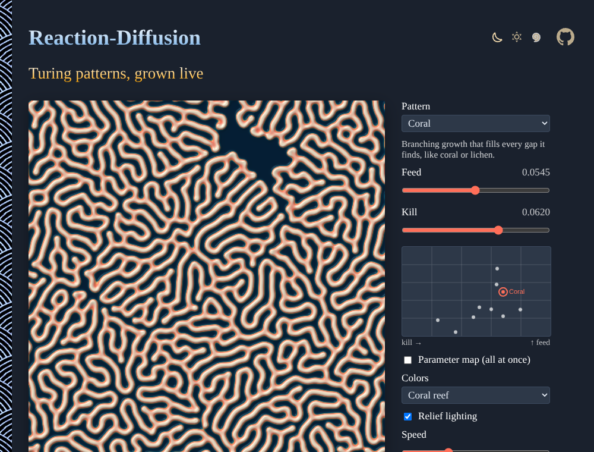

# Reaction-Diffusion

Turing patterns, grown live: two chemicals and two lines of math make the spots of a leopard, the stripes of a zebra, the branches of coral, worms that crawl apart and waves that never settle. Tune the feed and kill rates, paint with chemical B, explore the parameter map, and download the pattern as PNG. No sign-up and no libraries.

- [Grow a pattern](https://evoluteur.github.io/reaction-diffusion/)

[](https://evoluteur.github.io/reaction-diffusion/)

## What it does

- **Pattern**: ten named regimes of the Gray-Scott model (Coral, Mitosis, Spots, Labyrinth, Fingerprint, Worms, Holes, Waves, Chaos, U-skate), with a line on what each one does.
- **Feed** and **Kill** sliders, and a small **map** of the feed / kill plane: click anywhere on it to try a mix, or near a dot to pick a named pattern.
- **Parameter map**: feed varies from bottom to top and kill from left to right across the dish, so every pattern grows at once, side by side (as in John Pearson's 1993 map).
- **Paint** on the dish to add chemical B, Shift or right-click to wipe it away.
- **Colors** (Coral reef, Ink on paper, Ember, Ocean, Moss, Black & white) and **Relief lighting**, which shades the pattern as if it were embossed.
- **Speed**, **Pause** (or the space bar), **Reseed**, **Empty**, and **Download PNG**.
- The address of the page keeps the pattern and colors, to share it.

## How it is built

The dish is a 512 × 512 grid, wrapped at the edges, kept in two floating-point textures on the GPU (WebGL 2). Each frame, a fragment shader applies the Gray-Scott update to every cell several times over, reading the cell's eight neighbors for the diffusion (a 3 × 3 Laplacian with weights 0.2 to the sides and 0.05 to the corners), with diffusion rates of 1 for A and 0.5 for B:

```
A' = A + Da ∇²A − AB² + f (1 − A)
B' = B + Db ∇²B + AB² − (k + f) B
```

A second shader turns the amount of B into colors, with optional lighting from the slope of the pattern. The brush drops B as small speckles rather than a solid blot, since a large uniform patch dies out in the spot regimes while small seeds grow.

Plain HTML, CSS and JavaScript, with no dependencies and no build step. Just open `index.html`. The three color themes (dark, light and blue) are shared with my other projects (copied from [omg-themes](https://github.com/evoluteur/omg-themes)).

## A little history

In 1952 Alan Turing published *The Chemical Basis of Morphogenesis*, proposing that two substances reacting and diffusing at different speeds could break a uniform tissue into spots and stripes. The Gray-Scott model (1984) is a simple chemical system of that kind; John Pearson's *Complex Patterns in a Simple System* (Science, 1993) mapped its patterns over the feed and kill rates. Reaction-diffusion has since been observed in the stripes of zebrafish, the spacing of hair follicles and feathers, and the forming of the digits.

Reaction-Diffusion is open source at [GitHub](https://github.com/evoluteur/reaction-diffusion) with MIT license.

Had fun browsing the app? [Buy me a coffee by becoming a sponsor](https://github.com/sponsors/evoluteur).

You may also be interested in my other projects [Cymatics](https://github.com/evoluteur/cymatics) ([demo](https://evoluteur.github.io/cymatics/)), [Infinite-Coastlines](https://github.com/evoluteur/infinite-coastlines) ([demo](https://evoluteur.github.io/infinite-coastlines/)) and [Sunflower-Golden-Angle](https://github.com/evoluteur/sunflower-golden-angle) ([demo](https://evoluteur.github.io/sunflower-golden-angle/)). See them all on [Esoterica](https://evoluteur.github.io/esoterica.html).

Copyright (c) 2026 [Olivier Giulieri](https://evoluteur.github.io/).
